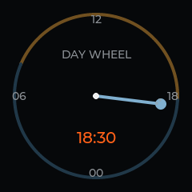

# Fosi Audio MD3: what's inside, and an open firmware

The Fosi Audio MD3 is a small USB-C DAC and headphone amplifier with a round 1.28-inch screen.
The idea is a good one: a DAC with a display you fill with your own pictures. The software
doesn't live up to it. We took full control of one unit's ESP32 software in five days, then
returned it. This repository holds everything we learned and the replacement firmware we wrote, so the
next owner (or Fosi) can start where we stopped.

**Status: archived, 2026-10-31.** The unit went back to the store with its factory flash
restored and verified byte for byte. Nothing here has been tried on a second unit.

## The verdict

The owner's, after five days of listening from a phone: "it just doesn't work good enough as a
DAC." What stood in the way, from [`docs/limits.md`](docs/limits.md):

- **One port, two devices.** Audio or Photo Sync, never both. Switching in the menu makes the
  computer see one device unplug and another arrive.
- **No working radio (on this unit).** The ESP32-S3 inside has Wi-Fi and Bluetooth, but our firmware heard 0
  Wi-Fi networks, and its Bluetooth beacon went unheard even by a phone held against the case.
- **The screen can't follow the music.** Its controller never sees audio. It learns the sample
  rate and the host volume, nothing more.
- **Stock firmware rough edges:** new pictures need a power cycle; PNG is accepted but never
  shown; the overvoltage warning only draws a label; first boot sets volume 100 of 100 with gain
  High; no public firmware or update tool exists.

## What we found

- **Two chips behind one USB-C port**, switched by a mux on ESP32 GPIO48: a Savitech SA9312L
  USB audio bridge (`262a:1a86`, UAC2 up to 384 kHz and native DSD256, plus a vendor HID
  channel), and an ESP32-S3R8 that runs the screen, buttons, menus and photo storage
  (`303a:4002`, a 22.9 MB FAT volume).
- **The ESP32 runs the DAC.** It drives the ESS ES9039Q2M over I2C at 0x48: volume, eight
  filters, gain. The Savitech reports the sample rate, DSD and host volume to it over a second
  I2C bus, where the ESP32 is a slave at 0x6B. Nothing flows back.
- **Wide open.** Secure boot and flash encryption are off. At every power-up the ESP32's
  USB-Serial-JTAG appears for about 1.1 s; catch it and the chip stays in ROM download mode, so
  you can dump and reflash it without opening the case.
- **The Savitech EEPROM can be read over HID** with a command recovered from another vendor's
  updater for the same chip family.

Details: [`docs/hardware.md`](docs/hardware.md), [`docs/stock-firmware.md`](docs/stock-firmware.md)
(pin map, DAC init, protocols, settings record, from disassembly),
[`docs/savitech.md`](docs/savitech.md).

## The open firmware

A from-scratch replacement for the ESP32-S3 app (ESP-IDF 5.5.1, LVGL 9.2) in `firmware/`. It
writes only the app partition at 0x10000 and keeps the audio path, the photo volume and the
settings format.

- Parity with stock: every sample rate and DSD, rate badge, volume, filters, gain, menus,
  persistent settings, album, the three games, DAC/U-Disk switching.
- Beyond stock: a 24-hour day-wheel clock with real sunrise and sunset arcs; a USB control
  channel that works while the drive is mounted (status, clock, keys, 0.3 s screenshots, log);
  20-second hands-free reflashing; a drive that comes back by itself after an eject.
- Not verified: power transitions.

Build, flash, restore, and the control channel: [`docs/open-firmware.md`](docs/open-firmware.md).
How it went: [`docs/history.md`](docs/history.md).

## Before you try any of it

- **Dump your own unit first** (all 32 MB, read twice) and keep it. You need it to go back:
  no Fosi firmware, art or documents are included here.
- **Never write the bootloader (0x0) or the partition table (0x8000), and never burn eFuses.**
  Leave those alone and the unit can't be bricked, since download mode lives in mask ROM.
- **Never send guessed HID output reports to the Savitech.** Unknown vendor commands on these
  bridges can enter an update mode. Only the EEPROM read is documented.
- Everything here was written and used on macOS.

## Layout

| Path | Contents |
|------|----------|
| `docs/` | Findings, reverse engineering, limits, history |
| `firmware/` | The ESP-IDF project (source only) |
| `tools/` | Python host tools: content, control channel, deploy, restore, boot-window catcher |
| `tests/host/` | Host-compiled C tests of the firmware's USB, storage and link code |
| `images/` | Screenshots taken over the control channel |

## Credits

The reconnaissance, the Savitech EEPROM read and most of the firmware were written by Kimi
K3.1 Pro in OpenCode. The stock-firmware disassembly, the self-reflashing path and the USB
control channel were written by Claude in Claude Code. The owner supplied the intent and the
cable replugs.

## License

MIT, see [`LICENSE`](LICENSE). Fosi Audio and MD3 are Fosi Audio's trademarks. This project is
not affiliated with or endorsed by Fosi Audio, Savitech, ESS or Espressif.
