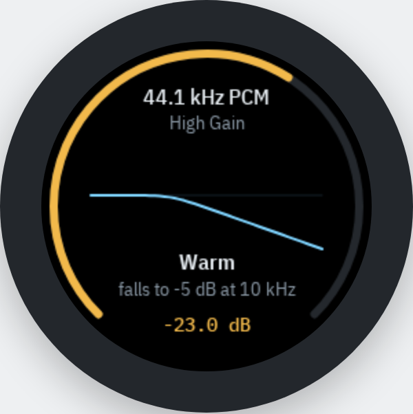

# md3fw 0.3.2

md3fw is a from-scratch replacement for the Fosi Audio MD3's ESP32-S3 app, in `firmware/`. ESP-IDF
5.5.1 (the version the stock image was built with), LVGL 9.2.2, TinyUSB through `esp_tinyusb`. It is
written for the existing partition table and only ever replaces the 9 MB `factory` app partition at
0x10000. It leaves the Savitech, the photo volume and the settings record format as Fosi made them,
so the stock firmware can be written back at any time.

0.3.1 runs on one unit (flashed 2026-11-11) that is used daily as a DAC for an iPhone. Flashing
and dumping are done from a Linux host.



*The status screen, rendered from [`design/status-screen.html`](../design/status-screen.html).*

## What changed in 0.3.2

- **Idle power.** The DAC's automatic clock gearing and automute are on (the stock firmware turned
  both off): after about 6 s of silence the DAC mutes and ramps its outputs to ground, 15 mW
  instead of 54 mW by the datasheet. After 30 s of automute, or of no stream, GPIO17 powers the
  four ES9603Q headphone amps down (AMP_PDB, pop-free by their datasheet, under 5 uA each) and
  the automute is then polled every 20 ms; the amps come back as soon as sound does. The first
  few tens of milliseconds after a long silence may be lost. `md3ctl info` shows `amp_on`.
- **Charger in the pass-through port.** A charge-state change only moves the "usb src" line. It
  no longer reruns the audio power-on, whose Savitech reset made the phone drop the DAC.

## What changed in 0.3.1

- **Louder default coefficient scale:** 2^23 for the 2x stage, 2^25 for the 4x stage, +3.0 dB trim
  (0.3.0 used 2^22 for both). Calibrated by ear, see
  [Coefficient scale](#coefficient-scale-and-how-to-calibrate-it).
- **New button map:** Menu turns the screen on and off and, held, switches DAC/U-Disk; Vista
  steps the presets (see [Controls](#controls)).
- **Gain on Vista hold:** High <-> Low, shown as "High Gain" or "Low Gain" at the top of the screen.
- **Stronger presets:** Bass and Treble ±6 dB, Mid ±5 dB, Warm and Bright tilting to ∓5 dB at 10 kHz.
- **Smooth curves:** the screen draws each preset's smooth target curve.
- **Curve scale:** 6 px per dB, ±7 dB, so the stronger presets fit.

## What changed in 0.3.0

Version 0.3.0 traded the gadget features for lower power and one useful screen. It first ran on
hardware as 0.3.1. The host tests were updated and compile-checked with the ESP32 cross compiler;
they have not been run on a host since.

- **No radios.** Wi-Fi and Bluetooth were never heard on the unit they were tested on ([`limits.md`](limits.md)), so
  0.3.0 drops them from the build: no Wi-Fi scan, no BLE beacon, no HTTP API, no mDNS
  (`CONFIG_BT_ENABLED=n`, and `main/` no longer links `esp_wifi`, lwIP or the HTTP server).
- **No album, games or clock.** The GIF and JPEG decoders, the Photo1-3/Game1-3 browser and the
  day-wheel are gone, along with the clock's USB requests (TIME, SUN) and the `MD3TIME.TXT`
  request file. Photo Sync itself is unchanged: the FAT volume, the non-formatting MSC path and
  the drive-return logic all stay, and the folders keep whatever is in them.
- **One status screen**, dark unless you press Menu (see [Controls](#controls)).
- **EQ presets** on the DAC's programmable interpolation filter (see [EQ presets](#eq-presets)).
- **Lower power:** 160 MHz instead of 240, dynamic frequency scaling down to 80 MHz, the screen
  and LVGL fully stopped while dark, and a UI task that sleeps until something happens instead of
  waking every 40 ms (see [Architecture](#architecture)).
- The settings record keeps its 24-byte layout. The EQ preset uses byte 0x11 (stock padding) and
  the EQ scale bytes 0x14-0x17 (stock "reserved"); the stock filter byte 0x03 and the album
  folder byte are kept as they are and ignored.

The app image is now about 0.77 MB (0.2.4: 1.6 MB).

## Before 0.3.0

Up to 0.2.4 the firmware matched the stock one (album, games, menus, eight filters) and added a
24-hour day-wheel clock, Wi-Fi and Bluetooth probes and a Wi-Fi HTTP API. That work was done by
[BenevolentFutures](https://github.com/BenevolentFutures/fosi-md3) on a unit they later returned.
The git history before the commit "Turn the radios off and drop Wi-Fi and Bluetooth from the build"
has the code, and [`history.md`](history.md) describes how it went. Kept from that time: the USB
control channel, hands-free reflashing (`tools/md3_deploy.py`) and the drive that comes back by
itself after an eject.

## Known issues

- **Charger in the pass-through port.** Before 0.3.2, plugging a charger in made an iPhone drop
  the MD3 until it was replugged. 0.3.2 skips the audio restart on a charge-state change; whether
  that is enough has not been tested yet.
- **Battery.** iOS put the MD3 at about 11% of an iPhone's battery per hour on the stock firmware
  and about 6.6% on 0.3.1 (Settings, Battery, "USB-C Accessories": its share times the day's
  total). Most of the rest is the USB audio bridge and the power supplies, which firmware does not
  control.

## Controls

| Key | Screen dark | Screen on |
|-----|-------------|-----------|
| Menu (GPIO8), click | Wakes the screen | Turns the screen off |
| Menu, hold 0.8 s | Wakes the screen | Switches DAC <-> U-Disk (Photo Sync); shows "DAC" or "U-Disk" for 1.5 s |
| Vol+ / Vol- (GPIO0 / GPIO9), click or hold | Changes the volume; the screen stays dark | Changes the volume and shows the level big for 1.5 s |
| Vista (GPIO10), click | Nothing | Next EQ preset |
| Vista, hold 0.8 s | Nothing | Switches the gain High <-> Low (Low is 6 dB of digital attenuation); shows it for 1.5 s |

Eight seconds after the last key the screen goes dark: backlight off, GC9A01 display off and
sleep in (0x28, 0x10), LVGL stopped. Waking sends sleep out (0x11), waits 120 ms, display on
(0x29), resumes LVGL and draws once before the backlight comes on. Holding Vista at power-up
still starts no application and keeps the ESP32's USB recovery path, as before.

Menu is GPIO8 in the stock firmware's pin map ([`stock-firmware.md`](stock-firmware.md)), which
calls it "Menu/enter". Vista is the front button.

Host volume, brightness, rotation and UAC 1.0/2.0 had menu items in 0.2.4 and have no
control since 0.3.0. Their saved values still apply, so set them with the stock firmware if they
need to change. The volume is the same 101-step stock curve.

### The status screen

Drawn as in [`design/status-screen.html`](../design/status-screen.html), on black:

- **Top:** the stream, from the Savitech link: "96 kHz PCM", "44.1 kHz PCM", "DSD128", or "no
  stream" while the link has reported no rate. The link carries no bit depth.
- **Centre:** the current preset's frequency response from 200 Hz to 20 kHz on a log axis, 6 px
  per dB around a 0 dB line. The points are the preset's smooth target curve, make-up
  included. `tools/eq_design.py` only offers a preset at a rate group where the real response of
  the quantized coefficients stays within 1 dB of that target (within 0.24 dB at 44.1/48 kHz),
  so the drawing leaves out only the small ripple. Flat draws a flat line (the
  built-in filter's own response is not modelled). The mock-up's impulse responses for the eight
  built-in filters were not carried over, since md3fw offers only F1.
- **Below the curve:** the preset name and a note. "Flat at this rate" when the preset has no
  coefficients for the stream's rate; on DSD the curve greys out and the note says "EQ not used
  on DSD".
- **Edge:** the device volume as an amber arc from 7 to 5 o'clock and its attenuation in dB at
  the bottom (before host volume, gain and EQ make-up); "mute" at 0. "High Gain" or "Low Gain" sits
  centred under the stream line. The 250 ms curve morph from the mock-up is not implemented.

## EQ presets

The ES9039Q2M's 8x interpolator can run from coefficient RAM instead of its eight built-in
filters (datasheet v0.2.3, "Customizable Programmable FIR Filters", registers 135-140): a 2x
stage of 128 coefficients (addresses 0x00-0x7F) followed by a 4x stage of 32 (0x80-0x9F, i.e.
PROG_COEFF_STAGE set), 24-bit signed, enabled with PROG_COEFF_EN (reg 135 bit 0). There is one
RAM for every sample rate, and DSD bypasses it.

| # | Preset | What you hear, relative to Flat | Make-up |
|---|--------|-------------------------------|---------|
| 0 | Flat | The built-in filter F1 (FILTER_SHAPE 0, PROG_COEFF_EN 0) | - |
| 1 | Bass+ | +6 dB below about 1 kHz | 6 dB |
| 2 | Bass- | -6 dB below about 1 kHz | 0 |
| 3 | Mid+ | +5 dB bell around 2 kHz (44.1/48 kHz only) | 5 dB |
| 4 | Mid- | -5 dB bell around 2 kHz (44.1/48 kHz only) | 0 |
| 5 | Treble+ | +6 dB shelf above about 5 kHz | 6 dB |
| 6 | Treble- | -6 dB shelf above about 5 kHz | 0 |
| 7 | Warm | Downward tilt from about 1 kHz: -5 dB at 10 kHz, -6.5 dB at 20 kHz | 0 |
| 8 | Bright | Upward tilt from about 1 kHz: +5 dB at 10 kHz, +6.5 dB at 20 kHz (the mirror of Warm) | 6.5 dB |

How they are made:

- Each custom preset is a whole anti-imaging interpolator. `tools/eq_design.py` (pure Python, no
  numpy) designs both stages by weighted least squares, linear phase: the 4x stage is flat to
  0.5 fs with its stopband from 1.45 fs; the 2x stage passes to 0.45 fs following the EQ shape
  (divided by the 4x stage's droop) and stops from 0.55 fs. It prints the target and achieved
  response and the worst image for every preset, and writes `firmware/main/eq_coeffs.h`.
- The EQ is defined in Hz but the filter scales with fs, so there is one 2x-stage set per rate
  group: 44.1/48, 88.2/96, 176.4/192 and 352.8/384 kHz, each designed at its 48 kHz-family rate.
  At 44.1 kHz and its multiples the same coefficients play about 8 % lower in frequency. The
  firmware reloads when the rate group changes.
- Every response peaks at 0 dB or below: a boost is made by cutting the rest of the band, and
  the DAC's volume registers give the level back (the make-up column), never going past 0 dB
  attenuation, so at the very top of the volume range the make-up runs out. Make-up applies only
  while a custom filter is in the signal path, never on DSD.
- A preset whose achieved curve misses its target by more than 1 dB (30 Hz-20 kHz) or lets an
  image through above -60 dB falls back to Flat at that rate, and the screen says so. Mid+ and
  Mid- exist only at 44.1/48 kHz by design. Bass+ and Bass- fall back from 176.4 kHz up: 128
  taps at 352.8 kHz and above cannot resolve a 1 kHz shelf. Elsewhere the worst error is about
  0.6 dB (bass at 88.2/96 kHz) and usually under 0.2 dB; images stay below about -69 dB.
- Loading mutes the DAC (0x4A/0x4B = 0xFF, then 60 ms for the volume ramp), clears
  PROG_COEFF_EN, writes all 160 coefficients (address, three data bytes, a PROG_COEFF_WE pulse),
  sets PROG_COEFF_EN and restores the volume. Reg 135 is read-modify-write, so its bit 7 (an
  unrelated S/PDIF setting) is kept. At 100 kHz I2C that is about 960 register writes; the log
  prints how long it took (estimated at 0.5-1 s, not measured). A DAC reset (power-up, mode
  switch, charge-state change) clears the RAM, and the firmware reloads after it.
- The preset is saved in settings byte 0x11. The stock firmware's filter byte (0x03) is left
  alone and not used.

### Coefficient scale and how to calibrate it

ESS does not say what a coefficient of 1.0 is. The tables assume **Q1.22**: the taps of a stage
with a DC gain of 1 sum to 2^22 (`EQ_COEF_UNITY_LOG2` in `eq_coeffs.h`), for both stages. If the
chip expects something else, every custom preset plays louder or quieter than Flat by the same
amount, or clips. The firmware can rescale at run time:

```sh
python tools/md3ctl.py eq-scale LOG2_2X LOG2_4X TRIM_DB    # firmware default: 23 25 3.0
```

A unity-gain 2x stage then sums to 2^LOG2_2X, the 4x stage to 2^LOG2_4X, and TRIM_DB (0.1 dB
steps, up to +-12 dB) is extra gain on the 2x stage. Each exponent may be 14-25; a scale that
would overflow 24 bits for any coefficient is refused (the request stalls). The scale is saved in
settings bytes 0x14-0x17 and survives unplugging. `md3ctl.py info` shows it under `eq`.

The control channel only exists in Photo Sync mode, and audio only plays in DAC mode, so
calibration goes back and forth:

1. **Keep the volume low** throughout (say -40 dB on the screen): a wrong scale can make a
   custom preset 12 dB louder than Flat, or clip hard.
2. In Photo Sync mode, set the default: `md3ctl.py eq-scale 22 22 0`.
3. Press Menu to wake the screen, hold Menu to switch to DAC, and play something with steady
   treble (pink noise, or cymbals and voices).
4. Compare **Flat** with **Bass+** (one Vista press apart): with the right scale the treble and
   upper mids are equally loud, and only the bass is lifted. Or compare Flat with **Bass-**
   (no make-up at all): everything above about 2 kHz should match exactly.
5. Judge the difference and adjust (hold Menu to go back to U-Disk, then `eq-scale` again):
   - the custom preset is about 6 dB quieter overall: `eq-scale 23 22`; about 12 dB: `24 22` or
     `23 23`. (The chip may want a 2x interpolator's taps to sum to 2, which is exactly this.)
   - it is louder, harsh or distorted: lower it, `eq-scale 21 22`, then `20 22`.
   - close but not equal: trim, e.g. `eq-scale 22 22 -0.5`.
   - near silence, noise or a whine at every setting: the format guess is wrong in a way scaling
     cannot fix (coefficient order, a different word layout). Go back to Flat and stop.
6. Only the total gain (both stages together) can be heard. Change LOG2_2X first and touch
   LOG2_4X only when the 2x exponent would overflow.

The calibrated scale for this unit is `eq-scale 23 25 3.0`: with 23/24/0, Warm at -28 dB
sounded as loud as Flat at -37 dB, so the presets needed 9 dB more. It is also the default from
0.3.1. A unit that already saved another scale keeps it until `eq-scale` is sent again.

To make a calibrated scale the default for new units, change the initial values in
`firmware/main/eq.c` (`s_log2_2x`, `s_log2_4x`, `s_trim`).

## The control channel

`bmRequestType` 0xC0 (IN) or 0x40 (OUT). OUT requests carry no data; arguments ride in
`wValue` and `wIndex`. Unknown requests stall. Defined in `firmware/main/usb_ctl.h`.

| Request | Dir | Effect | `md3ctl.py` |
|---------|-----|--------|-------------|
| 0x01 INFO | IN | status JSON: firmware, screen ("status" or "off"), storage owner, mode, VBUS, settings, EQ preset/state/scale, link rate | `info` |
| 0x02 TIME | OUT | retired in 0.3.0 with the clock; stalls | - |
| 0x03 KEY | OUT | wValue = key (vol_up, vol_down, menu, vista), wIndex = press (click, double, long, hold) | `key NAME [PRESS]` |
| 0x04 SHOT | IN | capture the screen as a BMP; returns its size | `shot [PATH]` (0.3 s) |
| 0x05 READ | IN | read the captured BMP at offset `(wIndex << 16) \| wValue` | (used by `shot`) |
| 0x06 LOG | IN | the newest firmware log text | `log` |
| 0x07 OFFER | OUT | give a device-held volume back to the computer now | `offer` |
| 0x08 ROM | OUT | reboot to ROM download mode (wValue 0x524D, wIndex 0x3344) | `rom` |
| 0x09 SUN | OUT | retired in 0.3.0 with the clock; stalls | - |
| 0x0A EQ_SCALE | OUT | wValue = log2 scale of the 2x stage \| 4x stage << 8, wIndex = int16 trim on the 2x stage in 0.1 dB; persisted; stalls if it would overflow | `eq-scale [L2X [L4X [TRIM_DB]]]` |

The KEY request accepts a key and press as the buttons do, so `md3ctl.py key menu` turns the
screen on or off, `md3ctl.py key vista` steps the preset, and `md3ctl.py key menu long` switches
modes while the screen is on. `md3ctl.py reenumerate`
resets the device's USB port from the host (a libusb reset, works on any firmware), which brings back a
volume left dark.

## Safety design

- **The photo volume can never be formatted by this firmware.** `esp_tinyusb`'s storage helper
  (`tusb_msc_storage.c`) calls `f_mkfs` when a mount fails, which would erase the photos on a
  single bad mount. That helper is excluded from the link; Photo Sync uses direct TinyUSB MSC
  callbacks in `usb_msc.c`, every FAT mount sets `format_if_mount_failed = false`, and a host
  test fails if `f_mkfs` is ever called.
- Raw sector writes from the computer are rejected while the firmware has the FAT mounted, and
  host attach and detach never unmount the wear-levelling layer.
- NVS errors never trigger an automatic erase.
- Holding Vista at boot starts no application services and leaves the ESP32's USB recovery path
  on the port.
- Every image must keep both ROM-request paths (`MD3_CTL_ROM` in `usb_ctl.c` and the
  `MD3ROM.TXT` request file checked in `ui.c`), or the next flash needs the boot window again.
  0.3.x keeps both, and the `MD3SHOT.TXT` and `MD3KEY.TXT` request files.
- EQ coefficients go to the DAC only while it is muted, and a failed load leaves the built-in
  filter selected with no make-up.

## Architecture

`app_main` sets up power management (160 MHz maximum, 80 MHz minimum, no automatic light
sleep), then NVS, settings, the EQ scale, the photo storage, USB mass storage, the Savitech link,
power monitoring and the audio power sequence (DAC included), then the backlight, LCD, UI and
buttons. The screen starts dark. After boot the UI task is the only owner of control: it
consumes one event queue, which serializes DAC, FAT, settings and screen work. USB control
requests validate and enqueue; they never touch those back ends directly.

The UI task sleeps on its queue. Keys and USB requests arrive there; the Savitech link's I2C
interrupt queues a single wake-up per burst of register writes, so the link is read as soon as
the bridge writes. Housekeeping runs every 250 ms (0.2.4: every 40 ms): VBUS sampling, the 2 s
deferred settings save, request files, returning the drive to the host, the 8 s screen timeout
and the EQ reload check. Long DAC work (an EQ load, the mode switch) runs outside the LVGL lock.

Power: the CPU runs at 80 MHz unless something holds a CPU_FREQ_MAX lock; the screen holds one
while it is on. The APB clock stays at 80 MHz either way on the S3, so I2C, SPI, LEDC and USB
timing do not change. Automatic light sleep stays off because it could miss writes on the
I2C-slave link and disturb USB. While the screen is dark, LVGL's tick timer and timers are
stopped (`lvgl_port_stop`), the backlight is off and the GC9A01 is in sleep mode.

## Build and flash

```sh
source ~/esp/esp-idf-v5.5.1/export.sh
cd firmware
idf.py build            # produces build/md3fw.bin
```

`sdkconfig.defaults`, `dependencies.lock` and `partitions.csv` (a copy of the factory table)
pin the build configuration. A clean build produces a 0.77 MB `md3fw.bin`. `sdkconfig` is
generated: after changing `sdkconfig.defaults`, delete it so the new defaults apply. Never run a
whole-flash command generated by `idf.py`: it would rewrite the bootloader and partition table.

`firmware/main/eq_coeffs.h` is generated by `python3 tools/eq_design.py` (pure Python, a second
or two) and committed; run it again after changing a preset.

### Linux host

The tools need the MD3's two Espressif USB ids to be usable without root: 303a:1001 (the boot
window's USB-Serial-JTAG, a `/dev/ttyACM*` node) and 303a:4002 (Photo Sync and the control
channel). A udev rule that gives both to `plugdev`, for a user in that group:

```
# /etc/udev/rules.d/70-md3.rules
SUBSYSTEM=="usb", ATTR{idVendor}=="303a", ATTR{idProduct}=="1001|4002", GROUP="plugdev", MODE="0660", ENV{ID_MM_DEVICE_IGNORE}="1"
SUBSYSTEM=="tty", ATTRS{idVendor}=="303a", ATTRS{idProduct}=="1001|4002", GROUP="plugdev", MODE="0660", ENV{ID_MM_DEVICE_IGNORE}="1"
```

`ID_MM_DEVICE_IGNORE` keeps ModemManager from probing the port during its one-second window.

Reload with `sudo udevadm control --reload` and replug. `catch_rom.py` only takes a fresh
`/dev/ttyACM*` node whose USB device is 303a:1001, so other Espressif devices on the same host
are left alone, and it waits until udev has made the node writable.

On macOS the port is `/dev/cu.usbmodem*` and needs no rule.

### Dump first

Run `python tools/catch_rom.py --dump`, then unplug and replug the MD3's bottom port without
touching a button. It catches the boot window, reads all 32 MB into
`backup/flash-<time>/flash-full.bin` with its sha256, and resets the chip into its app. Do it
twice and compare the hashes. [`hardware.md`](hardware.md) shows how to cut the factory app
partition out of the dump.

### First flash

With the stock firmware on the device: run `python tools/catch_rom.py --hold`, replug the MD3
into its bottom port, then write the app only:

```sh
python -m esptool --chip esp32s3 --port /dev/ttyACM0 \
  --before no-reset --after no-reset write-flash 0x10000 firmware/build/md3fw.bin
python tools/catch_rom.py --port /dev/ttyACM0     # watchdog reset into the app
```

Use the port `catch_rom.py` printed.

### Updates

With md3fw running and the MD3 in Photo Sync mode: `python tools/md3_deploy.py
firmware/build/md3fw.bin`. It asks for ROM mode over the control channel, writes 0x10000, reads
it back and restarts the app. Its fallbacks that go through the Photo Sync volume (the
`MD3ROM.TXT` request, the final check that the volume is back) find the volume with `mount` and
`diskutil` the macOS way; on Linux they do not find it, so the tool may report no volume at the
end even when the write and readback succeeded.

### Back to stock

`python tools/md3_factory_restore.py flash-full.bin` writes everything from 0x9000 onward from
your own dump, refuses to run if the bootloader or partition table differ, and verifies the
whole flash. Or write just the app partition back from the same dump (the `dd` slice in
[`hardware.md`](hardware.md)) with `esptool write-flash 0x10000 backup/factory-app.bin`.

## Host tests

```sh
TMPDIR=/tmp tests/host/run.sh
```

Needs a host C compiler (`cc`). Compiles the real `link.c`, `usb_msc.c`, `storage.c` and
`audio.c` against host stubs under UBSan, and checks Savitech link decoding (48k, 96k and 192k
cases) and the link's ISR wake-up hook, MSC identity and capacity,
raw-sector bounds, host mount and remount behaviour, returning the volume to the host (holds,
idle time), mount-failure cleanup, audio mode transitions, and the `f_mkfs` tripwire.

## Host tools

| Tool | Purpose |
|------|---------|
| `tools/md3.py` | Album and game content for the stock firmware: `status`, `ls`, `backup`, `convert`, `push`, `rm`, `restore`, `eject` (md3fw keeps the files but shows no pictures; macOS only) |
| `tools/md3ctl.py` | The USB control channel (`eq-scale` needs 0.3.0 or later) |
| `tools/eq_design.py` | Designs the EQ presets' coefficients and writes `firmware/main/eq_coeffs.h` |
| `tools/md3_deploy.py` | Hands-free write of a new build to 0x10000 with readback |
| `tools/md3_factory_restore.py` | Byte-for-byte return to your own factory dump |
| `tools/catch_rom.py` | Catch the boot window and hold the chip in download mode |
| `tools/descriptors.py` | Parse the USB configuration descriptor without opening the device |
| `tools/analyze_flash.py` | Partition table and image header from a flash dump |

Python 3.11 with `esptool` 5.x, `pyusb` (and libusb) and `Pillow`. Written on macOS and now used
from Linux for dumping, flashing and the control channel. The volume handling in `md3.py` and
`md3_deploy.py` still assumes macOS (`diskutil`, `dot_clean`).
