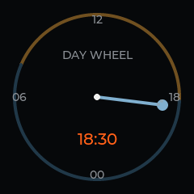
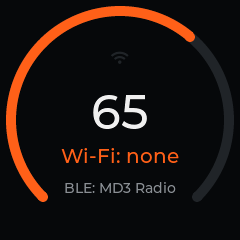

# The open firmware (md3fw 0.2.4)

A from-scratch replacement for the ESP32-S3 app, in `firmware/`. ESP-IDF 5.5.1 (the version the
stock image was built with), LVGL 9.2.2, TinyUSB through `esp_tinyusb`. It is written for the
existing partition table and only ever replaces the 9 MB `factory` app partition at 0x10000. It
leaves the Savitech, the photo volume and the settings record format as Fosi made them, so the
stock firmware can be written back at any time.

 

## What it does

Verified on hardware, 2026-10-29 to 2026-10-31:

- **Parity with stock:** audio at every rate and DSD (the DAC detects the format itself), the
  rate badge, volume keys, the eight filters, gain, menus, settings that persist across reboots,
  the album (GIF87a, GIF89a and JPEG), all three games, and DAC/U-Disk switching.
- **The day-wheel:** a 24-hour clock with one hand, noon at the top, and day and night arcs
  from the real sunrise and sunset. It shows no hand until the computer has set the time, since
  the device has no clock that survives an unplug.
- **A USB control channel** (Photo Sync mode): vendor requests on endpoint 0 that work while
  the computer keeps the drive mounted. Driven by `tools/md3ctl.py`.
- **Hands-free reflashing:** the firmware reboots itself into ROM download mode on request, so
  `tools/md3_deploy.py` writes, reads back and restarts a new build in about 20 s with nobody
  touching the device.
- **The drive comes back by itself:** after any eject (by a tool, Finder, or macOS at wake),
  the firmware checks for request files and returns the volume to the computer about 2 s later.
  It keeps the volume while the album is on screen.

Not verified: power transitions (the charging states the stock firmware handles in its ADC
task).

Radio probes: every boot runs one Wi-Fi scan, and a Bluetooth LE beacon ("MD3 Radio") broadcasts
for as long as the device runs. On our unit neither was ever heard. The source also holds a Wi-Fi
station with an authenticated HTTP API (`net.c`), which starts only if Wi-Fi credentials are
provisioned in NVS; it never was. Remove the `net_start()` and `radio_ble_start()` calls in
`main.c` if you don't want the radios on.

## The control channel

`bmRequestType` 0xC0 (IN) or 0x40 (OUT). OUT requests carry no data; arguments ride in
`wValue` and `wIndex`. Unknown requests stall. Defined in `firmware/main/usb_ctl.h`.

| Request | Dir | Effect | `md3ctl.py` |
|---------|-----|--------|-------------|
| 0x01 INFO | IN | status JSON: firmware, screen, clock, sun, storage owner, mode, VBUS, settings, link rate | `info` |
| 0x02 TIME | OUT | wValue = minute of day, wIndex = second | `time [HH:MM[:SS]]` |
| 0x03 KEY | OUT | wValue = key (vol_up, vol_down, menu, vista), wIndex = press (click, double, long, hold) | `key NAME [PRESS]` |
| 0x04 SHOT | IN | capture the screen as a BMP; returns its size | `shot [PATH]` (0.3 s) |
| 0x05 READ | IN | read the captured BMP at offset `(wIndex << 16) \| wValue` | (used by `shot`) |
| 0x06 LOG | IN | the newest firmware log text | `log` |
| 0x07 OFFER | OUT | give a device-held volume back to the computer now | `offer` |
| 0x08 ROM | OUT | reboot to ROM download mode (wValue 0x524D, wIndex 0x3344) | `rom` |
| 0x09 SUN | OUT | wValue = sunrise minute, wIndex = sunset minute | `sun [RISE SET]` |

`md3ctl.py sun` with no arguments computes the times from `MD3_LATITUDE` and `MD3_LONGITUDE`.
`md3ctl.py sync` sends time and sun in one call; `md3ctl.py reenumerate` resets the device's USB
port from the host (IOKit, works on any firmware), which brings back a volume left dark.

## Safety design

- **The photo volume can never be formatted by this firmware.** `esp_tinyusb`'s storage helper
  (`tusb_msc_storage.c`) calls `f_mkfs` when a mount fails, which would erase the photos on a
  single bad mount. That helper is excluded from the link; Photo Sync uses direct TinyUSB MSC
  callbacks in `usb_msc.c`, every FAT mount sets `format_if_mount_failed = false`, and a host
  test fails if `f_mkfs` is ever called.
- Raw sector writes from the computer are rejected while the firmware has the FAT mounted, and
  host attach and detach never unmount the wear-levelling layer.
- NVS errors never trigger an automatic erase.
- Holding Vista at boot starts no application services and leaves the ESP32's USB recovery path
  on the port.
- Every image must keep both ROM-request paths (`MD3_CTL_ROM` in `usb_ctl.c` and the
  `MD3ROM.TXT` request file checked in `ui.c`), or the next flash needs the boot window again.

## Architecture

`app_main` initializes NVS, settings, the photo storage, USB mass storage, the Savitech link,
power monitoring and the audio power sequence (DAC included), then the backlight, LCD, UI and
buttons, and last the Wi-Fi probe and the BLE beacon. After boot the UI task is the only owner of
control: it consumes one event queue and does the link, power and deferred-settings
housekeeping, which serializes DAC, FAT, settings and screen work. USB control requests and
network handlers validate and enqueue; they never touch those back ends directly.

## Build and flash

```sh
source ~/esp/esp-idf-v5.5.1/export.sh
cd firmware
idf.py build            # produces build/md3fw.bin
```

`sdkconfig.defaults`, `dependencies.lock` and `partitions.csv` (a copy of the factory table)
pin the build configuration. A clean build of this tree produced a 1.6 MB `md3fw.bin`. Never run a whole-flash command generated by `idf.py`: it would
rewrite the bootloader and partition table.

First flash (stock firmware on the device): run `tools/catch_rom.py --hold`, plug the MD3 into
its bottom port, then write the app only:

```sh
python -m esptool --chip esp32s3 --port /dev/cu.usbmodemXXXX \
  --before no-reset --after no-reset write-flash 0x10000 firmware/build/md3fw.bin
python tools/catch_rom.py --port /dev/cu.usbmodemXXXX     # watchdog reset into the app
```

After that, with the MD3 in Photo Sync mode: `python tools/md3_deploy.py firmware/build/md3fw.bin`.

Back to stock: `python tools/md3_factory_restore.py flash-full.bin` writes everything from
0x9000 onward from your own dump, refuses to run if the bootloader or partition table differ,
and verifies the whole flash. Or write just the app partition back from the same dump (the
`dd` slice in [`hardware.md`](hardware.md)) with `esptool write-flash 0x10000 backup/factory-app.bin`.

## Host tests

```sh
TMPDIR=/tmp tests/host/run.sh
```

Compiles the real `link.c`, `usb_msc.c`, `storage.c` and `audio.c` against host stubs under
UBSan, and checks Savitech link decoding (48k and 96k cases), MSC identity and capacity,
raw-sector bounds, host mount and remount behaviour, returning the volume to the host (album
hold, idle time), mount-failure cleanup, audio mode transitions, and the `f_mkfs` tripwire.

## Host tools

| Tool | Purpose |
|------|---------|
| `tools/md3.py` | Album and game content: `status`, `ls`, `backup`, `convert`, `push`, `rm`, `restore`, `eject` (works with the stock firmware) |
| `tools/md3ctl.py` | The USB control channel (0.2.4) |
| `tools/md3_deploy.py` | Hands-free write of a new build to 0x10000 with readback |
| `tools/md3_factory_restore.py` | Byte-for-byte return to your own factory dump |
| `tools/catch_rom.py` | Catch the boot window and hold the chip in download mode |
| `tools/descriptors.py` | Parse the USB configuration descriptor without opening the device |
| `tools/analyze_flash.py` | Partition table and image header from a flash dump |
| `tools/make_gif.py` | A 240x240 test card |

Python 3.11 with `esptool` 5.x, `pyusb` (and libusb) and `Pillow`. Written and used on macOS; the
volume handling in `md3.py` and `md3_deploy.py` assumes macOS (`diskutil`, `dot_clean`).
